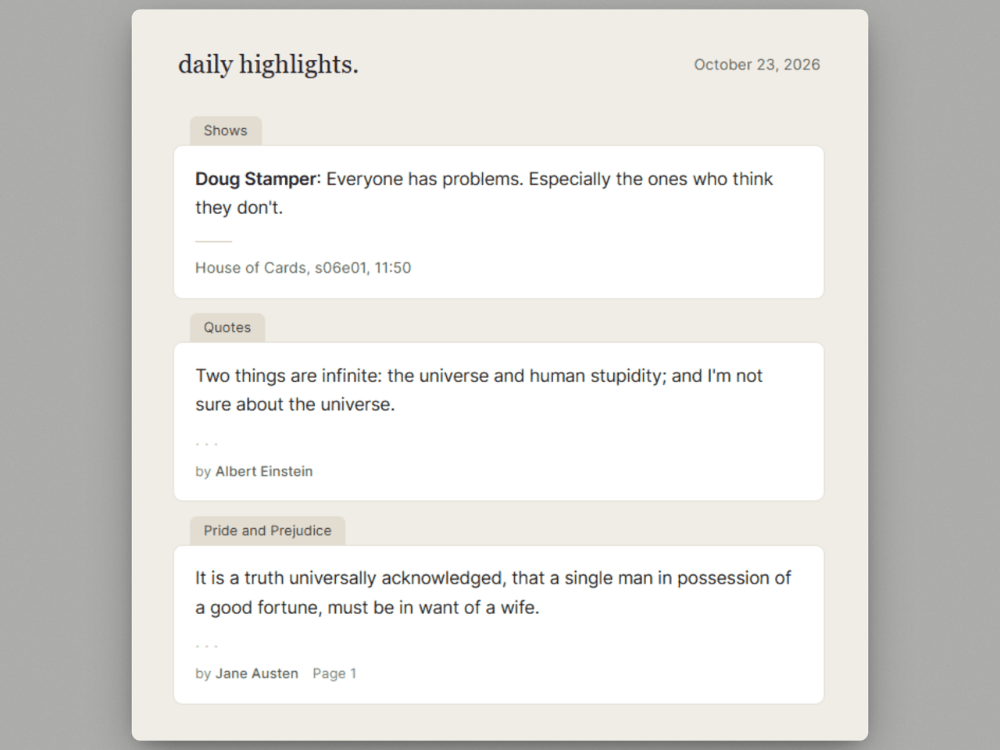

# Daily Highlights

An open-source, self-hosted alternative to Readwise's Daily Review. Keep your book and article highlights in a Google Sheet, and get a few random ones in your inbox every day.

No servers, no subscriptions, no third-party access to your notes. It's one Google Sheet and one Apps Script project.

## Features

- Random highlights from every visible sheet in your spreadsheet, delivered by email on a daily schedule
- Each highlight is its own card, with the sheet name on a tab above it
- Optional notes, page numbers, authors and source links
- Bold, italic, underline and hyperlinks from your sheet are preserved in the email
- Light and dark mode, plus a plain-text version for clients that don't render HTML
- Multiple recipients, each receiving their own copy (addresses are never shown to other recipients)
- Least-privilege access: the script can only read your spreadsheets and send email
- Two-step setup: one function to test, one to schedule

## Quick start

1. **Copy the template.** Open the [template sheet](https://docs.google.com/spreadsheets/d/1LMPKP1ImGbkZsgPDJ4_QdrmhH784p7wKd8fADxx3brM/edit) and choose **File > Make a copy**.
2. **Open the script editor.** In your copy, choose **Extensions > Apps Script**.
3. **Paste the code.** Replace the contents of the default `Code.gs` with the `Code.gs` from this repository, then save.
4. **Set script properties.** In **Project Settings > Script properties**, add:

   | Property | Required | Value |
   |---|---|---|
   | `SPREADSHEET_ID` | Yes | The ID from your sheet's URL: `docs.google.com/spreadsheets/d/<THIS_PART>/edit` |
   | `RECIPIENT_EMAIL` | Yes | Your email. Use a comma-separated list for several recipients. Plain addresses only (`a@example.com`, not `Name <a@example.com>`). |

5. **Test it.** Select the `setup` function in the editor toolbar and click **Run**. Google will ask you to authorize the script the first time. You should receive a test email within a minute.
6. **Schedule it.** Select `createDailyTrigger` and click **Run**. The email is sent once a day around the hour set in `CONFIG.triggerHour` (default 8:00, in the script's time zone).

To stop the emails, run `deleteTriggers`.

### Optional: check the time zone

**Check the time zone.** The daily trigger uses the script's time zone, which normally matches your spreadsheet's. If emails arrive at the wrong hour, set **Project Settings > Time zone**. Don't copy the `timeZone` value from this repository's `appsscript.json`, which is `Europe/Prague`.

## Sheet format

Each sheet (tab) is one book or article, and the **sheet name is used as the title**. Row 1 is always a header row.

| Column | Field | Required |
|---|---|---|
| A | Highlight | Yes |
| B | Author | No |
| C | Note | No |
| D | Page | No |
| E | Source URL | No |

Rules:

- **Every visible tab is read.** Hidden tabs and tabs listed in `CONFIG.excludedSheets` are skipped. Keep instructions and scratch notes in a hidden tab, or add the tab name to `excludedSheets`.
- Row 1 is a header and is never sent.
- A row is used only if the Highlight column is filled in. Cells showing a formula error (`#REF!`, `#N/A`, `#VALUE!` and similar) are ignored.
- Empty and header-only sheets are skipped.
- Empty optional fields are left out of the email.
- Source URL must start with `http://` or `https://`. It can be the URL itself, or a cell with a hyperlink attached (for example the text "Source" linked to the page).
- Rich text formatting and links in the Highlight and Note columns are kept.
- Format columns B, D and E as plain text (**Format > Number > Plain text**). Google Sheets can turn values like `3-4` or `1/2` into dates, and date values are ignored in the Author, Page and Source URL columns. A page value of `0` is also treated as empty.

## What the email looks like

Each highlight is a card with the sheet name on a tab above it. Inside the card:

1. The highlight text
2. The note, if there is one, below a short divider
3. A footer with the author (shown as "by Author"), the page, and a link to the source

Fields you leave empty are left out. The email follows your device's light or dark setting in most mail apps. Gmail on the web may ignore the dark styles and show the light version.

**Links show where they go.** When a link's visible text doesn't already contain its destination, the domain is shown in small text after it, for example `Read more (example.com)`. This matters if other people can edit your sheet, because link text alone can be misleading.

## Configuration

Defaults live in the `CONFIG` object at the top of `Code.gs`:

| Setting | Default | Description |
|---|---|---|
| `numHighlights` | `4` | Highlights per email. Must be a positive integer. |
| `subject` | `Daily Highlights` | Email subject. Also used as the heading, shown in lowercase with a period. |
| `senderName` | `Daily Highlights` | Sender display name |
| `triggerHour` | `8` | Hour used by `createDailyTrigger`. Integer from 0 to 23. |
| `skipHiddenSheets` | `true` | Ignore hidden tabs. Set to `false` to read them. |
| `excludedSheets` | `[]` | Tab names to ignore, for example `['Instructions', 'Scratch']` |
| `columns` | A to E | Zero-based column positions for each field |

Your spreadsheet ID and email address are stored in Script Properties, not in the code, so they never end up in version control. Invalid settings stop the script with a clear error instead of sending a broken email.

## Functions

| Function | Purpose |
|---|---|
| `sendRandomHighlight` | Builds and sends the digest. This is what the trigger runs. |
| `setup` | Checks your configuration and sends a test email |
| `createDailyTrigger` | Creates (or replaces) the daily trigger |
| `deleteTriggers` | Removes the daily trigger |

## Privacy and permissions

- The script runs in your own Google account. Nothing is sent to any third party.
- Permissions needed: access to your spreadsheets, sending email as you, and managing its own triggers.
- Each recipient gets a separate email, so recipients can't see each other's addresses or reply to everyone.
- Anyone with edit access to your spreadsheet or script can change what is emailed and to whom. Share both carefully.

## Troubleshooting

- **"Missing script property"**: add the property named in the error under **Project Settings > Script properties**.
- **"Invalid address in RECIPIENT_EMAIL"**: use plain addresses separated by commas, without display names.
- **"No valid highlights found"**: check that column A is filled, that row 1 is a header row, and that the tab isn't hidden or listed in `excludedSheets`. The daily run now fails with this error, so Google's failure notification email will tell you.
- **"Not enough daily email quota"**: Apps Script limits emails per day, and the limit is lower for free Google accounts than for Workspace accounts. Each recipient counts as one email.
- **"Failed to send to ..."**: the listed addresses were rejected. Everyone else still received their email.
- **No email arrives**: check your spam folder, then open **Executions** in the Apps Script editor to see the error.
- **A page number or author is missing**: the cell was probably converted to a date. Format the column as plain text and re-enter the value.
- **The source link is missing**: the cell must contain, or be hyperlinked to, a URL starting with `http://` or `https://`.
- **Highlights from a tab you didn't expect**: every visible tab is read. Hide it or add it to `excludedSheets`.
- **Authorization warning**: the script needs read access to your spreadsheets and permission to send email as you. It runs entirely in your own Google account.